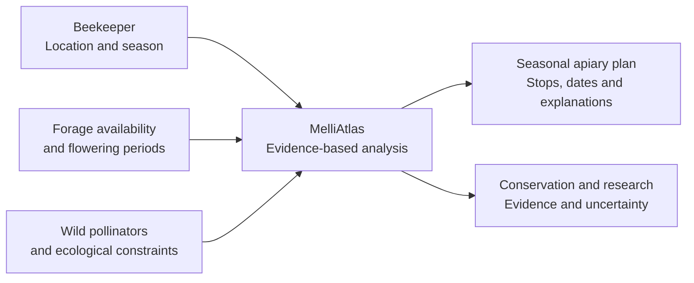
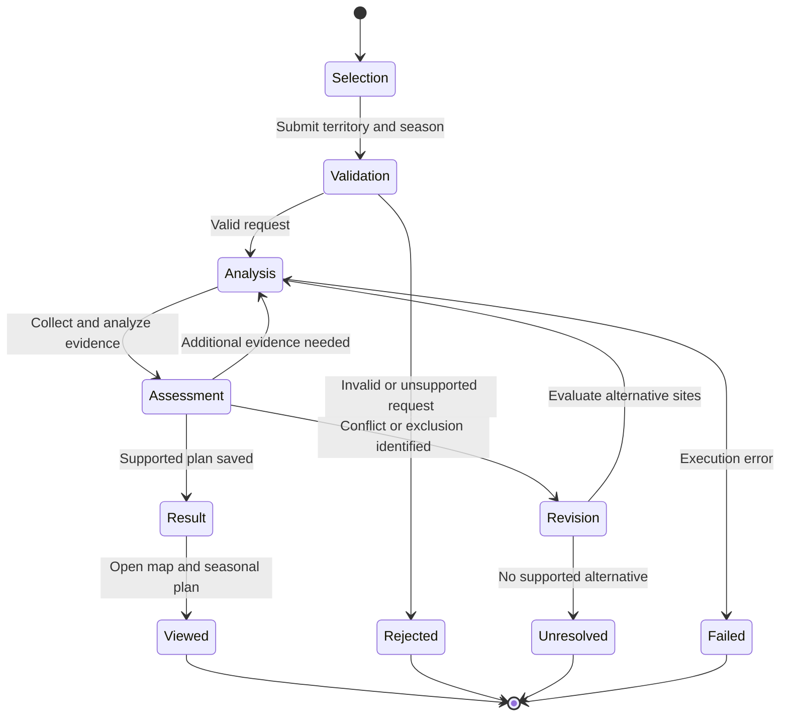

# MelliAtlas

MelliAtlas is a geospatial decision-support application for **seasonal apiary placement and migratory beekeeping**. It helps beekeepers compare forage opportunities across territories and plan when to move an apiary during the flowering season. The application gives equal consideration to the conservation of wild pollinators and sensitive habitats.

The intended result is an **explainable seasonal placement plan**: candidate stops, proposed dates, reasons for selection or rejection, alternative locations, and the limits of the available evidence. MelliAtlas does not guarantee honey yield or certify that a location is ecologically safe.

## Purpose and users

MelliAtlas is designed around three related uses:

- **Beekeeping:** compare seasonal forage windows, identify gaps between flowering periods, and plan successive apiary stops with practical and ecological constraints.
- **Conservation:** identify protected or sensitive areas, distinguish binding restrictions from potential ecological concerns, and compare less disruptive placement options.
- **Research:** examine geographic and seasonal evidence about managed and wild pollinators. Later stages will support field observations, research datasets, and multi-year monitoring.

The first working product serves a beekeeper planning a seasonal relocation. Conservation checks are part of that workflow from the beginning; research tools are introduced incrementally.

## Conceptual model

The same territory may offer significant forage resources while also containing habitats where additional managed honey bees would be undesirable. MelliAtlas must evaluate these considerations together. A documented legal restriction, a possible ecological conflict, and a lack of information are **different findings** and must not be presented as interchangeable conclusions.

## Investigation lifecycle

A beekeeper selects a **country, region, supported district, and planning season**, and then requests an investigation. The proposed workflow is shown below. This is a **conceptual state diagram**, not a list of currently implemented API statuses or evidence of live provider access.

The transitions have the following meaning:

| State or transition | Expected behavior |
| --- | --- |
| **Selection → Validation** | The user supplies a territory and season. The server verifies supported administrative scope, dates, and the selected scenario. |
| **Validation → Analysis** | An accepted request starts an investigation with a stable identifier; the user can inspect its progress. Invalid or unsupported requests return a structured explanation. |
| **Analysis → Assessment** | The engine loads the applicable reference and synthetic evidence, invokes registered sources and analyzers, and evaluates forage opportunities and ecological constraints. |
| **Assessment → Analysis** | When relevant evidence is missing or inconsistent, the bounded agent may request an additional permitted check. |
| **Assessment → Revision → Analysis** | An excluded or unsuitable candidate causes the agent to consider alternatives and repeat the necessary analysis, rather than silently retaining the original site. |
| **Assessment → Result → Viewed** | When evidence supports a plan, the result and decision trace are stored and presented as a map, ordered stops, a timeline, and explanations. Completed results can be reopened by investigation ID. |
| **Rejected / Unresolved / Failed** | Invalid input, lack of a supportable plan, and execution errors produce distinct diagnostics. None is represented as a successful recommendation. |

The diagram describes the **investigation workflow**, not the final persistence schema. Backend job statuses are defined separately by the active backend specification; the initial MVP may execute jobs in process, while durable worker recovery is planned for a later stage.

## Evidence and analysis

MelliAtlas is intended to combine geographic, temporal, agricultural, and ecological information. Potential sources include administrative boundaries and maps; vegetation and flowering calendars; public websites and news in Russia and Belarus; Russia-only FGIS Saturn evidence; weather information; protected-area restrictions; field observations of wild pollinators; and privately supplied apiary or travel constraints.

Potential processing components include geographic normalization, source provenance checks, forage-window analysis, spatial screening, comparison of candidate stops, uncertainty assessment, and seasonal plan construction. Sources provide data; analyzers process it; the engine executes typed dependent operations; and the agent determines whether further checks or revised candidates are necessary. These components are planned capabilities, not claims that the integrations already exist.

In **`MVP-01`**, Russia and Belarus require reference maps and regional catalogs, with district catalogs for Smolensk and Vitebsk Oblasts. Planning evidence, public-website/news samples, and Saturn examples remain **synthetic or fixture-based**. Real public-web/news ingestion for both countries and verified Saturn integration for Russia are scheduled for **`MVP-02`**, subject to source-access, licensing, and data-meaning checks.

Every significant conclusion should retain its source, relevant dates and geographic scope, the transformation or rule applied, and uncertainty. Synthetic material must be labeled as synthetic. The absence of evidence about pesticide treatments, wild pollinators, or nearby apiaries is not evidence that the area is safe.

## Development roadmap and current status

The product is developed in independently testable increments. **`MVP-01` must deliver an end-to-end browser workflow**, including a React/Leaflet map, a Python/FastAPI backend, a minimal deterministic agent, synthetic placement analysis with ecological screening, and reopening a completed result from PostgreSQL/PostGIS. Later stages add real data adapters, richer seasonality, stronger conservation and relocation analysis, optional LLM planning, research tools, and long-term ecological monitoring.

**Current status:** the implemented backend provides a FastAPI application factory, a health endpoint, OpenAPI metadata, and initial tests. Typed territory contracts, an offline reference validator, and versioned territory reads are now implemented, but no complete approved RU/BY catalog or real geometry dataset is loaded. PostGIS persistence, source adapters, the planning engine, agent behavior, and the React user interface are not yet implemented. Both diagrams describe the intended product behavior.

## Architecture and project documentation

The planned application is a **Python modular monolith** with FastAPI, PostgreSQL/PostGIS, and a single responsive React/TypeScript web client. An independent Python worker is introduced when durable background execution becomes necessary. LLM-based planning is optional; the initial agent must work without an LLM.

| Directory | Responsibility |
| --- | --- |
| `backend/` | API, domain contracts, sources, analyzers, execution, and persistence |
| `web/` | Map, seasonal plan, evidence presentation, and future research views |
| `config/countries/` | Country-specific configuration |
| `docs/specs/` | Umbrella specification, active sub-specifications, plans, and checkpoints |

The [umbrella specification](docs/specs/umbrella_spec_melliatlas.md) defines the roadmap and acceptance criteria. The [specification index](docs/specs/README.md) identifies the active workstream and the documents governing implementation. See [installation](docs/INSTALLATION.md) and [testing](docs/TESTS.md) for the currently supported commands.
