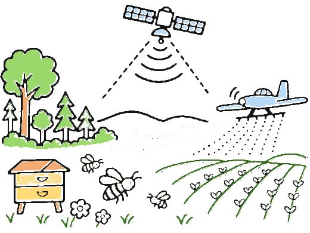
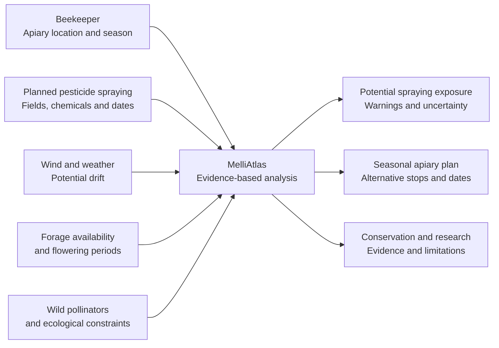

# MelliAtlas

MelliAtlas is a geospatial decision-support application for **protecting apiaries from planned pesticide treatments and planning seasonal migration**. Its primary practical question is: which reported field treatments may affect an apiary during a proposed stop, when might they occur, and what alternative locations or dates warrant review? Forage availability, regional geography, agricultural notices and weather-dependent exposure must be assessed together. Conservation of wild pollinators and sensitive habitats remains a first-class constraint.

The intended result is an **explainable seasonal placement plan**: candidate stops, proposed dates, reasons for selection or rejection, alternative locations, and the limits of the available evidence. MelliAtlas does not guarantee honey yield or certify that a location is ecologically safe.

## Purpose and users

MelliAtlas is designed around three related uses:

- **Beekeeping and pesticide exposure:** compare announced field treatments with planned apiary sites and dates, identify potentially affected stops and alternative windows, then assess forage and ecological constraints. Source reports and forecast-driven exposure estimates must not be mistaken for confirmed harm or safety.
- **Conservation:** identify protected or sensitive areas, distinguish binding restrictions from potential ecological concerns, and compare less disruptive placement options.
- **Research:** examine geographic and seasonal evidence about managed and wild pollinators. Later stages will support field observations, research datasets, and multi-year monitoring.

The first working product serves a beekeeper planning a seasonal relocation. Conservation checks are part of that workflow from the beginning; research tools are introduced incrementally.

## Conceptual model

A reported spraying plan is not proof that spraying occurred, but its location, timing and potential weather-dependent drift may warrant precautions or a different apiary stop. Missing treatment reports or weather evidence do not establish safety. The same territory may also offer valuable forage while containing sensitive habitats; documented restrictions, potential ecological conflicts and missing information must remain distinct findings.

## Investigation request lifecycle

A beekeeper selects a **country, region, supported district, planning season, and point X**, then requests an investigation. The following table describes the conceptual request-and-result interactions, distinguishing the synthetic or fixture-based `MVP-01` workflow from later-stage integrations. It is not an inventory of implemented API operations.

The interactions have the following meaning:

| Interaction | Expected behavior |
| --- | --- |
| **Request investigation** | The beekeeper submits point X and planning context. The server validates the request and returns an investigation identifier; it does not wait for every analysis step to finish. |
| **Collect and cache evidence** | Registered adapters collect permitted, attributed reports of planned field spraying (locations, application windows and chemicals), together with other relevant evidence. The source cache/store is separate from saved analysis results. `MVP-01` uses synthetic/fixture evidence, not live spraying reports. |
| **Analyze and persist** | The intended analysis compares apiary locations and dates with reported spraying areas and schedules, forage and ecological constraints, and weather or wind evidence where available. The investigation service owns result lifecycle and persistence. A completed result and its decision trace remain immutable; real PostGIS acceptance is still pending. |
| **Poll for the result** | Repeated requests can return a pending status, a completed assessment, or an explicit failure. A technically completed analysis may still report insufficient evidence or no feasible seasonal plan. |
| **Assessment and recommendations** | Results distinguish potential exposure, precautionary conditions and unknown coverage, explain evidence limitations, and propose alternative stops or dates when supported. A spraying notice is not proof of actual application, and no recommendation certifies safety. |
| **Later-stage data updates** | Corrected spraying notices or updated weather evidence may warrant a new immutable assessment, without rewriting earlier results. Automatic collection, forecast-driven reassessment and alerts are outside `MVP-01`. |

These interactions describe a **request-and-result lifecycle**, not definitive job-state or persistence schemas. The active backend specification governs accepted MVP behavior; full durable execution, live source ingestion and forecast-based reassessment remain separate future deliverables.

## Evidence and analysis

MelliAtlas is intended to combine geographic, temporal, agricultural, and ecological information. Potential sources include administrative boundaries and maps; vegetation and flowering calendars; public websites and news in Russia and Belarus; Russia-only FGIS Saturn evidence; weather information; protected-area restrictions; field observations of wild pollinators; and privately supplied apiary or travel constraints.

Potential processing components include geographic normalization, source provenance checks, forage-window analysis, spatial screening, comparison of candidate stops, uncertainty assessment, and seasonal plan construction. Sources provide data; analyzers process it; the engine executes typed dependent operations; and the agent determines whether further checks or revised candidates are necessary. These components are planned capabilities, not claims that the integrations already exist.

In **`MVP-01`**, Russia and Belarus require reference maps and regional catalogs, with district catalogs for Smolensk and Vitebsk Oblasts. Planning evidence, public-website/news samples, and Saturn examples remain **synthetic or fixture-based**. An offline parser now handles the historically observed Russia-only `/planapplybees` treatment-page shape, preserving per-field plan IDs, publication and application dates, source-declared products, and nullable field geometry. A separate pure screening function compares fictional notices against candidate site windows and polygons, reporting unknowns rather than clearance. The offline treatment evidence now feeds fictional treatment-only and joint ecology/treatment investigations through the existing HTTP API. Verified live RU Saturn and approved RU/BY website ingestion remain gated work for `MVP-02`; weather/wind exposure modeling is not implemented.

Every significant conclusion should retain its source, relevant dates and geographic scope, the transformation or rule applied, and uncertainty. Synthetic material must be labeled as synthetic. The absence of evidence about pesticide treatments, wild pollinators, or nearby apiaries is not evidence that the area is safe.

## Development roadmap and current status

The product is developed in independently testable increments. **`MVP-01` must deliver an end-to-end browser workflow**, including a React/Leaflet map, a Python/FastAPI backend, a minimal deterministic agent, synthetic placement analysis with ecological screening, and reopening a completed result from PostgreSQL/PostGIS. Later stages add real data adapters, richer seasonality, stronger conservation and relocation analysis, optional LLM planning, research tools, and long-term ecological monitoring.

**Current status:** the implemented backend provides a FastAPI application factory, a health endpoint, OpenAPI metadata, and initial tests. Typed territory contracts, an offline reference validator, and versioned territory reads are now implemented, but no complete approved RU/BY catalog or real geometry dataset is loaded. A development-only synthetic RU scenario now supports in-process investigation creation, deterministic forage-window selection and repeat reads by UUID; it has no real provider access or durable storage. An opt-in PostGIS completed-snapshot adapter exists but has not passed real-database acceptance. An opt-in fictional ecology investigation connects pure geometry checks to bounded agent replanning through the existing jobs and HTTP API. A separate fictional treatment investigation uses planned-spraying claims to prefer a provisional alternative and expose dates, reported chemicals and explicit unknowns. An additional joint fictional investigation requires both ecological and treatment checks to accept a stop; none validates actual safety. An offline Saturn-shaped notice normalizer supplies fictional treatment evidence for the treatment-only and joint investigations. The original V01 synthetic scenario remains unchanged, and no ecological result has been verified against real-world data. Real source adapters, the full engine/integrated agent, and full React Web acceptance remain pending. A first single-client React/Leaflet W01 workspace is now supplied as a partial implementation, subject to local dependency resolution, typechecks and browser tests. Live source ingestion and weather-driven drift analysis are not yet implemented. The conceptual diagram and lifecycle table describe the intended product behavior.

## Architecture and project documentation

The planned application is a **Python modular monolith** with FastAPI, PostgreSQL/PostGIS, and a single responsive React/TypeScript web client. An independent Python worker is introduced when durable background execution becomes necessary. LLM-based planning is optional; the initial agent must work without an LLM.

| Directory | Responsibility |
| --- | --- |
| `backend/` | API, domain contracts, sources, analyzers, execution, and persistence |
| `web/` | Map, seasonal plan, evidence presentation, and future research views |
| `config/countries/` | Country-specific configuration |
| `docs/specs/` | Umbrella specification, active sub-specifications, plans, and checkpoints |

The [source evidence register](docs/source-register.md) records historical Saturn protocol leads and Russian publication candidates without granting collection permission. The [umbrella specification](docs/specs/umbrella_spec_melliatlas.md) defines the roadmap and acceptance criteria. The [specification index](docs/specs/README.md) identifies the active workstream and the documents governing implementation. See [installation](docs/INSTALLATION.md) and [testing](docs/TESTS.md) for the currently supported commands.

### Experimental RU-only Saturn notice preview

An independently enabled `MELLIATLAS_SATURN_LIVE_ENABLED=true` mode now adds a
manual one-page read of public Saturn beekeeper notices for RU only. The Web
client discovers the capability from the backend and shows its reported field
polygons separately from fictitious investigation plans; BY does not receive
this source. The HTTPS request profile is based on an older observed portal
payload and was **not** verified against the current live service. Errors and
unknown coverage remain explicit, and source reuse rights require independent
validation before deployment. See [installation](docs/INSTALLATION.md).
