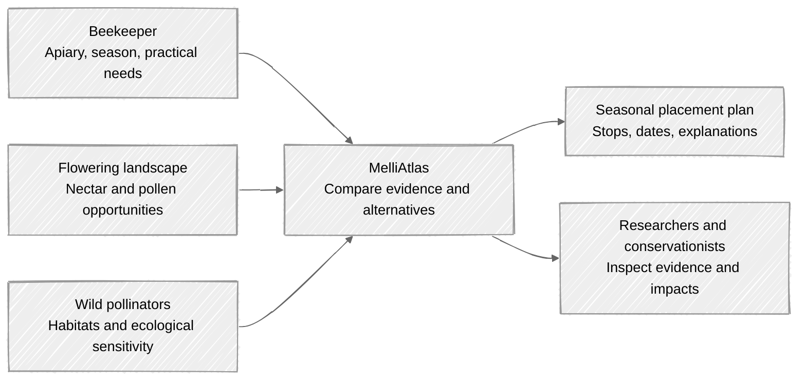
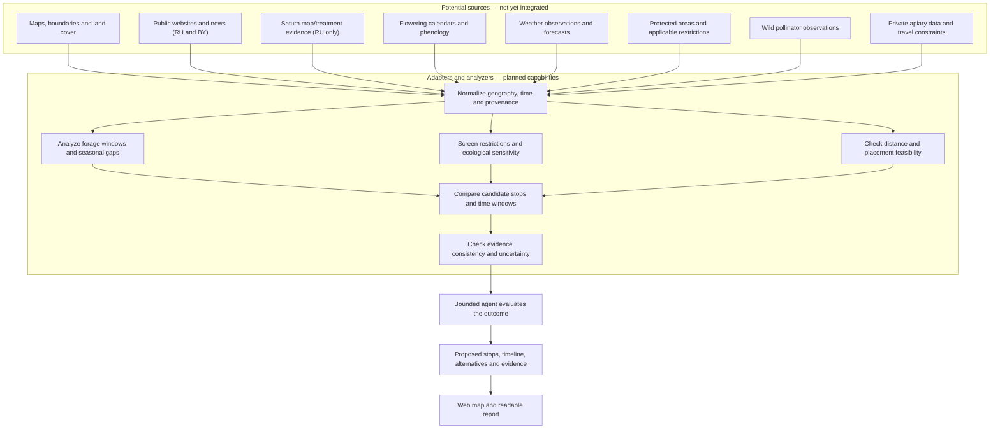

# MelliAtlas

**Follow the bloom. Respect the wild.**

Imagine a beekeeper planning the next move in the middle of the flowering season. A meadow looks promising, but will it still provide forage next week? Is another area better timed for the next honey flow? And could moving managed honey bees there place additional pressure on wild pollinators or conflict with a protected habitat?

**MelliAtlas helps people ask those questions together.** It is a geospatial decision-support application for migratory beekeeping, pollinator conservation, and, as the product grows, ecological research. Its purpose is to suggest *explainable seasonal apiary plans*—not to maximize honey harvest at any cost.

## One landscape, two responsibilities

A productive site is not automatically a suitable site. MelliAtlas must distinguish **verified legal restrictions**, **possible ecological concerns**, and **unknown conditions**. A site may be rejected under an applicable documented rule, flagged for further investigation, or left undecided when evidence is insufficient. No arbitrary universal exclusion radius or unsupported claim of ecological safety is acceptable.

### Three ways to use the same evidence

- **For beekeepers:** explore forage opportunities, compare possible stops, identify seasonal gaps, and consider when a move might make sense for the colonies.
- **For conservation teams:** inspect sensitive areas, assess potential conflicts with wild pollinators, and compare placement alternatives without confusing modeled impacts with established harm.
- **For ecologists and biologists:** eventually compare territories and seasons, test hypotheses, contribute observations, and track ecosystem changes over years.

The **first user journey serves the beekeeper**. Conservation constraints are part of that journey from day one; richer research and field-monitoring workflows arrive in later stages.

## From scattered evidence to a seasonal plan

A user selects a territory and season, starts an investigation, and receives candidate stops on a map and a proposed relocation timeline. The application should explain **why** a site was selected, rejected, or reconsidered, which evidence was used, and what remains uncertain.

The following is a **conceptual future processing DAG**, not a claim that these sources, adapters, or analyzers already exist. In `MVP-01`, planning evidence and remote-publication/Saturn responses are explicitly **synthetic or fixture-based**; the RU/BY map and territorial catalogs are sourced reference geography with documented version and rights. Actual public-web/news and Saturn integrations begin in `MVP-02`, subject to independent access and evidence verification.

The graph depicts **one execution pass**. If the agent finds missing or conflicting evidence, it can request permitted additional operations and submit a *new* dependency graph. This preserves an acyclic execution plan while allowing adaptive investigation. Sources and analyzers are intended to expose typed, testable contracts rather than hidden application-specific shortcuts.

## Start small, keep improving

The first stage, **`MVP-01`**, must already deliver a working browser-to-PostGIS application: a React/Leaflet map, a Python/FastAPI backend, complete first-order regional navigation for Russia and Belarus, district catalogs for Smolensk and Vitebsk Oblasts, minimal typed analysis operations, and a bounded deterministic agent. A synthetic example will propose at least two successive apiary stops, detect a fictional exclusion rule, reconsider an attractive location, and explain an alternative. A completed result can be reopened.

Subsequent stages expand the **same working product** with approved public-web/news collection in Russia and Belarus, controlled Saturn integration in Russia, better flowering evidence, more adaptive planning, durable jobs and caching, multi-district comparisons, further verified real data, weather-aware phenology, stronger conservation analysis, colony and agricultural considerations, constrained relocation planning, optional LLM support, scientific comparison, and eventually field observations and multi-year monitoring.

**Limits matter:** the software does not issue permits, guarantee honey yield, certify the absence of ecological harm, or establish scientific causation from a map correlation. Synthetic data must never appear to be live observations. Sensitive apiary coordinates and protected species locations require appropriate access controls.

## How the repository fits together

| Directory | Planned responsibility |
| --- | --- |
| `backend/` | Python/FastAPI API, analysis engine, agent, source/analyzer contracts, and persistence |
| `web/` | React/TypeScript/Vite/Leaflet experience for maps, timelines, evidence, and research views |
| `config/countries/` | Country-specific settings when supported territories are introduced |
| `docs/specs/` | Product requirements, stage lifecycle, active plans, and checkpoint contracts |

The preferred architecture is a **Python modular monolith** backed by **PostgreSQL/PostGIS**, with an independent worker when durable execution is introduced. The browser is a single responsive application. LLM planning is optional: the initial agent works without an LLM.

**Current status:** this repository is a scaffold with a draft product umbrella, not a running GIS service or a provider-integrated research system. The diagrams describe intended capabilities, not implemented or scientifically validated behavior.

Read the [umbrella specification](docs/specs/umbrella_spec_melliatlas.md) for the ordered stages and acceptance outcomes, or the [specification index](docs/specs/README.md) for the documentation lifecycle. Once a stage is selected, its sub-specification and implementation plan define the approved work. Run `bash ./run-tests.sh` to check documentation integrity; application-specific test commands will be added when product code is introduced.
