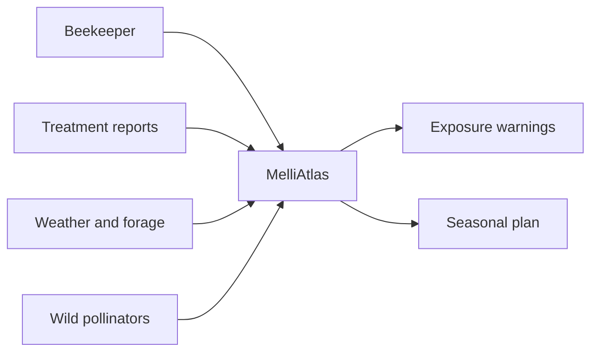

# MelliAtlas

MelliAtlas helps a **beekeeper** compare planned pesticide treatments with potential apiary locations, flowering seasons, weather and ecological constraints. It also supports future **conservation** and research workflows for managed and **wild pollinators**. The goal is an explainable seasonal plan, not a guarantee of yield or safety.

## Purpose and users

- **Beekeepers:** review treatment notices, candidate sites and alternative dates.
- **Conservation:** consider protected habitats and wild pollinators.
- **Researchers:** explore traceable geographic and seasonal evidence in later stages.

## Conceptual model

## Investigation lifecycle

The request-and-result interactions are: select a territory and season, request an investigation, read evidence, then review warnings and candidate stops. Completed results are intended to be immutable. **MVP-01** currently uses synthetic or fixture-based treatment and ecology evidence; real treatment ingestion and drift modeling are **outside `MVP-01`**.

Missing treatment reports are **not evidence that the area is safe**. A notice is not confirmation that spraying occurred.

## Current status

- **Implemented:** React/Leaflet map, RU/BY region navigation, PostGIS-backed reviewed ADM1/ADM2 reads when data is explicitly imported, bounded experimental Saturn (RU) and Open-Meteo weather previews, an explicit online GeoNames/Open-Meteo settlement search, and a developer-only synthetic investigation fixture route (`/developer-demo`).
- **Not yet implemented:** complete live treatment analysis, reliable pesticide-drift assessment, a verified seasonal migration optimizer and production-ready persistence.
- **Pending verification:** actual administrative coverage in each selected region, source licensing/age, and end-to-end browser behavior on imported PostGIS data.

## Run locally

See [Installation](docs/INSTALLATION.md) for database, boundary imports, backend and web setup. The temporary [sub-spec development workflow](docs/DEVELOPMENT_WORKFLOW.md) keeps all tasks on one feature branch and defers **all** tests (unit, UI/E2E and integration) and full `CHK` until the end-of-sub-spec review gate. The retained full suite is `sh ./run-tests.sh`; source formatting is `sh ./run-format.sh`.

Architecture and requirements: [Specification index](docs/specs/README.md), [Backend](backend/README.md), [Web](web/README.md).
