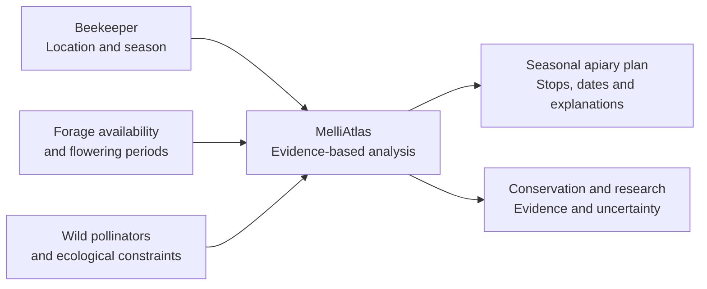

# MelliAtlas

MelliAtlas is a geospatial decision-support application for **seasonal apiary placement and migratory beekeeping**. It helps beekeepers compare forage opportunities across territories and plan when to move an apiary during the flowering season. The application gives equal consideration to the conservation of wild pollinators and sensitive habitats.

The intended result is an **explainable seasonal placement plan**: candidate stops, proposed dates, reasons for selection or rejection, alternative locations, and the limits of the available evidence. MelliAtlas does not guarantee honey yield or certify that a location is ecologically safe.

## Purpose and users

MelliAtlas is designed around three related uses:

- **Beekeeping:** compare seasonal forage windows, identify gaps between flowering periods, and plan successive apiary stops with practical and ecological constraints.
- **Conservation:** identify protected or sensitive areas, distinguish binding restrictions from potential ecological concerns, and compare less disruptive placement options.
- **Research:** examine geographic and seasonal evidence about managed and wild pollinators. Later stages will support field observations, research datasets, and multi-year monitoring.

The first working product serves a beekeeper planning a seasonal relocation. Conservation checks are part of that workflow from the beginning; research tools are introduced incrementally.

## Conceptual model

The same territory may offer significant forage resources while also containing habitats where additional managed honey bees would be undesirable. MelliAtlas must evaluate these considerations together. A documented legal restriction, a possible ecological conflict, and a lack of information are **different findings** and must not be presented as interchangeable conclusions.

## Investigation request lifecycle

A beekeeper selects a **country, region, supported district, planning season, and point X**, then requests an investigation. The following table describes the conceptual request-and-result interactions, distinguishing the synthetic or fixture-based `MVP-01` workflow from later-stage integrations. It is not an inventory of implemented API operations.

The interactions have the following meaning:

| Interaction | Expected behavior |
| --- | --- |
| **Request investigation** | The beekeeper submits point X and planning context. The server validates the request and returns an investigation identifier; it does not wait for every analysis step to finish. |
| **Collect and cache evidence** | Registered adapters provide permitted source observations with provenance. The source cache/store is separate from saved analysis results. `MVP-01` uses synthetic/fixture planning evidence, not live news or Saturn ingestion. |
| **Analyze and persist** | The engine evaluates geographic, forage and ecological evidence; the investigation service owns the result lifecycle and coordinates persistence. A completed investigation and its decision trace remain immutable. PostGIS-backed durability is planned but not yet implemented. |
| **Poll for the result** | Repeated requests can return a pending status, a completed assessment, or an explicit failure. A technically completed analysis may still report insufficient evidence or no feasible seasonal plan. |
| **Assessment and recommendations** | Results distinguish exclusion, caution and unknown conditions near point X, propose nearby alternatives when supported by evidence, and support the product goal of a seasonal plan with at least two stops. They do not certify a site as safe or legally available. |
| **Later-stage data updates** | Approved source or weather changes can lead to a new assessment and a new immutable investigation/version; they must not rewrite an earlier completed result. Scheduled forecast ingestion is outside `MVP-01`. |

These interactions describe a **request-and-result lifecycle**, not definitive job-state or persistence schemas. The active backend specification governs accepted MVP behavior; full durable execution, live source ingestion and forecast-based reassessment remain separate future deliverables.

## Evidence and analysis

MelliAtlas is intended to combine geographic, temporal, agricultural, and ecological information. Potential sources include administrative boundaries and maps; vegetation and flowering calendars; public websites and news in Russia and Belarus; Russia-only FGIS Saturn evidence; weather information; protected-area restrictions; field observations of wild pollinators; and privately supplied apiary or travel constraints.

Potential processing components include geographic normalization, source provenance checks, forage-window analysis, spatial screening, comparison of candidate stops, uncertainty assessment, and seasonal plan construction. Sources provide data; analyzers process it; the engine executes typed dependent operations; and the agent determines whether further checks or revised candidates are necessary. These components are planned capabilities, not claims that the integrations already exist.

In **`MVP-01`**, Russia and Belarus require reference maps and regional catalogs, with district catalogs for Smolensk and Vitebsk Oblasts. Planning evidence, public-website/news samples, and Saturn examples remain **synthetic or fixture-based**. Real public-web/news ingestion for both countries and verified Saturn integration for Russia are scheduled for **`MVP-02`**, subject to source-access, licensing, and data-meaning checks.

Every significant conclusion should retain its source, relevant dates and geographic scope, the transformation or rule applied, and uncertainty. Synthetic material must be labeled as synthetic. The absence of evidence about pesticide treatments, wild pollinators, or nearby apiaries is not evidence that the area is safe.

## Development roadmap and current status

The product is developed in independently testable increments. **`MVP-01` must deliver an end-to-end browser workflow**, including a React/Leaflet map, a Python/FastAPI backend, a minimal deterministic agent, synthetic placement analysis with ecological screening, and reopening a completed result from PostgreSQL/PostGIS. Later stages add real data adapters, richer seasonality, stronger conservation and relocation analysis, optional LLM planning, research tools, and long-term ecological monitoring.

**Current status:** the implemented backend provides a FastAPI application factory, a health endpoint, OpenAPI metadata, and initial tests. Typed territory contracts, an offline reference validator, and versioned territory reads are now implemented, but no complete approved RU/BY catalog or real geometry dataset is loaded. A development-only synthetic RU scenario now supports in-process investigation creation, deterministic forage-window selection and repeat reads by UUID; it has no real provider access or durable storage. An opt-in PostGIS completed-snapshot adapter exists but has not passed real-database acceptance. Pure fictional ecology geometry/policy and a bounded decision-only agent can now demonstrate evidence-driven alternative selection and explicit unknown/limit outcomes independently of HTTP. Neither is connected to the existing V01 investigation flow or verified against real-world ecology. Real source adapters, the full engine/integrated agent, and the React user interface are not yet implemented. Both diagrams describe the intended product behavior.

## Architecture and project documentation

The planned application is a **Python modular monolith** with FastAPI, PostgreSQL/PostGIS, and a single responsive React/TypeScript web client. An independent Python worker is introduced when durable background execution becomes necessary. LLM-based planning is optional; the initial agent must work without an LLM.

| Directory | Responsibility |
| --- | --- |
| `backend/` | API, domain contracts, sources, analyzers, execution, and persistence |
| `web/` | Map, seasonal plan, evidence presentation, and future research views |
| `config/countries/` | Country-specific configuration |
| `docs/specs/` | Umbrella specification, active sub-specifications, plans, and checkpoints |

The [umbrella specification](docs/specs/umbrella_spec_melliatlas.md) defines the roadmap and acceptance criteria. The [specification index](docs/specs/README.md) identifies the active workstream and the documents governing implementation. See [installation](docs/INSTALLATION.md) and [testing](docs/TESTS.md) for the currently supported commands.
